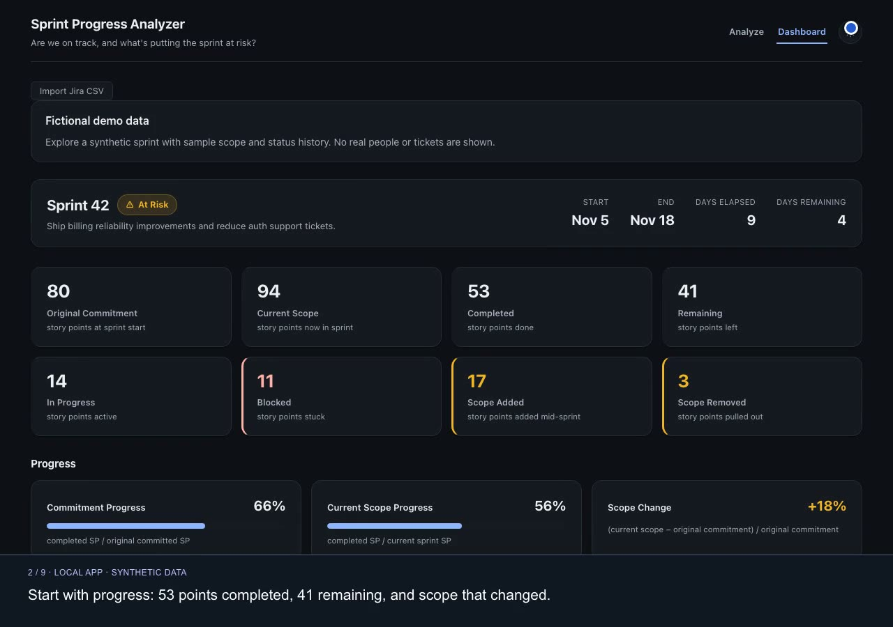
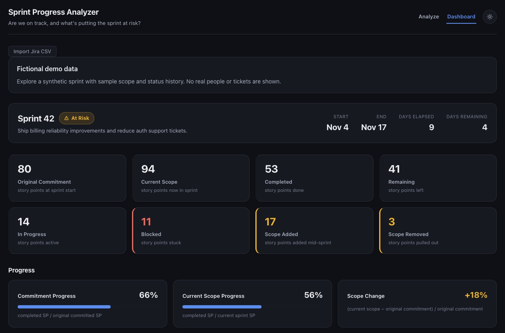
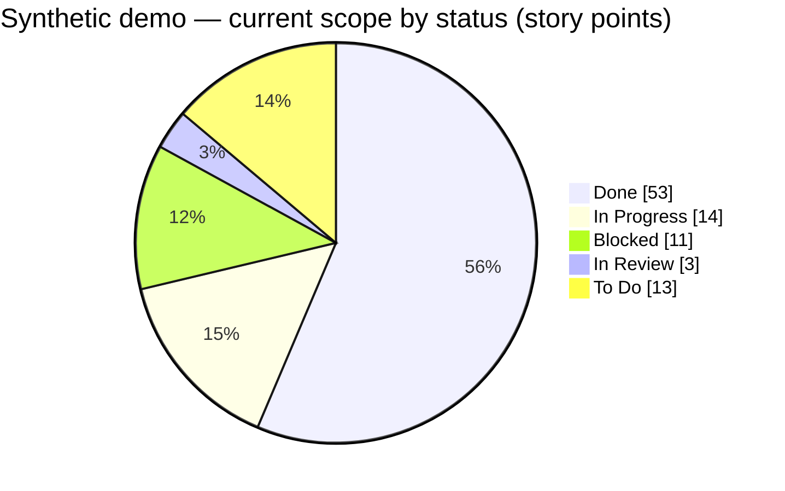
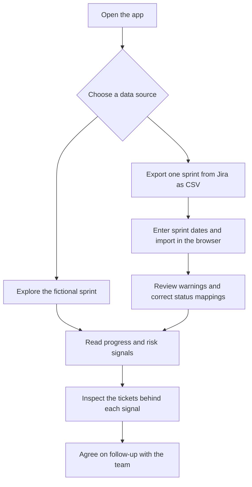
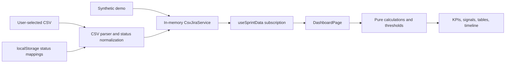

# Sprint Progress Analyzer

A local-first Jira sprint dashboard for engineering managers, delivery leads, and teams reviewing delivery risk. It puts commitment, current scope, blocked work, aging issues, and missing estimates in one view so a sprint conversation can focus on decisions and follow-up.

## Try it

For prerequisites, step-by-step instructions, and troubleshooting, see [setup.md](setup.md).

```bash
npm ci
npm run dev
```

Open http://localhost:5173/dashboard for the synthetic demo, or http://localhost:5173/analyze to import a CSV. The homepage is at `/`. Demo dates are relative to the current date; demo people and tickets are fictional.

For a reproducible import, select [examples/sprint.csv](examples/sprint.csv), set sprint dates to November 2–16, 2026, and import. Map `Discovery` to your chosen status and re-import. This fixture is synthetic; its dates are fixed, so aging signals depend on when you open it. Reset to demo data to return to the rolling demo.

## Short product walkthrough

[](docs/media/sprint-walkthrough.mp4)

[Watch or download the approximately 70-second MP4](docs/media/sprint-walkthrough.mp4). The silent, captioned recording shows the real local app with synthetic data: progress, blocked work, CSV import, status correction, unavailable history, and reset. [Read the transcript or regenerate the recording](docs/demo-walkthrough.md).

## Dashboard preview



Captured from the local running app on November 13, 2026, using only the built-in synthetic data. Browser chrome and margins are cropped; the dashboard content is unchanged. Demo dates roll forward when you open the app. A hosted synthetic demo is available for private owner review; no public demo is advertised. Use the local setup to explore the app.


For a plain-English walkthrough, read [Reading your sprint dashboard](docs/user-guide.md): importing a file, understanding the numbers, and turning risk signals into team conversations.

## Demo at a glance

The built-in synthetic sprint starts with **80 story points** of commitment. Adding 17 and removing 3 brings current scope to **94 points**: 53 completed and 41 remaining.



This is a data visualization of [the demo fixture](src/data/mockData.ts), not a screenshot or forecast. Unestimated issues contribute no points to this chart and are flagged separately in the dashboard. The 11 blocked points and added scope give a reviewer concrete risks to discuss alongside completion progress.

## From sprint data to a team conversation



The dashboard supports the conversation; it does not change Jira tickets or make delivery commitments for the team. See [the user guide](docs/user-guide.md) for what each signal means.

## Product and engineering evidence

- [First user-feedback sessions](docs/user-feedback.md): an invitation, observation tasks, and a blank session worksheet; no feedback is claimed yet.
- [Product case study](docs/product-case-study.md): the problem, scope decisions, tradeoffs, and user research still needed.
- [Accessibility checks](docs/accessibility.md): covered routes, keyboard behavior, fixes, and verification limits.
- [Performance measurements](docs/performance.md): reproducible synthetic parser and browser-import results, including a large-import responsiveness limit.

## Working features

- Commitment, current scope, completed, remaining, in-progress, and blocked story-point totals.
- Separate progress views for original commitment and current scope.
- Delivery pipeline, explanatory risk signals, issue filters, timeline, and scope-change table.
- CSV parsing with quoted fields, embedded newlines, header aliases, duplicate-key suppression, and import warnings.
- Custom status corrections saved in browser localStorage, with edit and reset controls.
- Light/dark theme and responsive layouts.

Historical scope changes are demonstrated by the built-in dataset. A standard CSV import does **not** contain the history needed to recover them.

## Architecture

React 19, TypeScript, Vite 8, React Router 7, plain CSS, and Vitest with jsdom. No application backend or direct Jira API connection.



`src/types/jira.ts` defines the domain model. `src/services/jira/` contains the service interface and CSV-backed implementation. `src/utils/` holds parsing, calculations, workflow grouping, and thresholds. Pages compose components; the hook subscribes to import/reset notifications. CSV content lives only in memory and is lost on refresh; theme and status mappings persist locally.

## Engineering decisions and tradeoffs

- **Start with CSV:** useful without credentials, OAuth, or a server. The cost is incomplete historical data and manual exports. Filter the Jira export to the intended sprint before importing; the parser does not select a sprint from a multi-sprint export.
- **Keep risk explainable:** individual signals expose the facts and threshold rationale. The headline status reflects the worst signal severity; it is a heuristic, not a delivery forecast or productivity score.
- **Separate calculations from rendering:** pure functions make scope accounting and edge cases directly testable. A service interface separates reads from the UI, but live Jira integration would still require authentication, pagination, historical-data handling, and changes to the CSV-specific import flow.
- **Use small dependencies:** local state, a service subscription, CSS progress bars, and a CSS timeline fit this single-sprint tool without a global state or charting library.
- **Expose uncertainty:** null estimates remain visible rather than silently counting as estimated work; zero-denominator progress is represented as unavailable.

## Setup and configuration

Use Node.js 22.12+ and npm. A lockfile is committed; `npm ci` installs its exact dependency resolution. No environment variables are required.

Optionally copy `.env.example` to `.env.local`. All `VITE_*` values are public browser configuration and must never contain secrets. Empty values leave analytics and ad placements unconfigured. Google Analytics loads only in production when a measurement ID is set. Advertising script loading is explicitly disabled in `src/utils/adsense.ts`; publisher IDs alone do not enable it. `public/ads.txt` contains a pre-existing public publisher declaration, not a credential.

Imports are parsed locally and are not explicitly sent by the app to an API. Optional third-party analytics receives page views, including page URL/title; avoid sensitive information in URLs and leave it disabled for a minimal local setup. Third-party scripts should be reviewed before enabling them for sensitive workflows.

```bash
npm run test     # unit tests for calculations, CSV parsing, workflow, mappings
npm run lint     # static analysis
npm run build    # TypeScript checks and production bundle
npm run preview  # serve the production bundle locally (after build)
```

The existing `vercel.json` rewrites SPA routes to `index.html`. Other hosts need equivalent route fallback. The existing noindex metadata and disabled advertising policy are preserved; publishing the source does not configure hosting.

## Validation

[GitHub Actions CI](https://github.com/kchan1028/sprint-progress-analyzer/actions/workflows/ci.yml) runs a clean npm install, unit tests, lint, the TypeScript check and production build, and the Playwright browser and accessibility checks on pull requests and pushes to `main`, using Node.js 22. On pull requests, a dependency review job fails the PR if it adds a dependency with a known high or critical vulnerability. A newer push to a PR cancels the older run. The workflow uses read-only repository permissions, pinned action commits and no secrets. [Dependabot](.github/dependabot.yml) opens monthly update PRs for npm packages and workflow actions. The default branch requires a pull request; the checks are not yet required status checks.


The preparation checks passed: 57 tests across seven suites, lint, and a TypeScript/production build. Tests cover calculation edge cases, CSV parsing, workflow grouping, persisted mapping behavior, import error feedback, and data provenance across imports and resets. An additional 18 Playwright checks cover the complete CSV import/mapping/reset journey, invalid imports, representative keyboard behavior, and axe/layout checks at desktop and emulated phone widths. See [docs/publication-review.md](docs/publication-review.md) for the publication review scope.

## Known limitations and next steps

- CSV imports treat every issue as original commitment. Scope additions/removals cannot be inferred; zero changes means unavailable history, not proof of stable scope.
- The `Updated` timestamp approximates entry into the current status and completion dates. Edits can make aging/timeline values misleading; Jira date formats also depend on browser parsing. Prefer ISO dates in exports.
- Unknown statuses default to To Do until corrected. Saved mappings apply within the browser origin and can be wrong for another team's workflow.
- Thresholds are fixed in code, days are calendar days, and there is no capacity model, cross-sprint trend, or prediction.
- Imports are memory-only, and large browser imports can stall rendering; see the measured limits above. Browser coverage currently uses Chromium, with no physical-device or full assistive-technology review.
- Next steps: validate usefulness with prospective users, evaluate changelog-backed data before building forecasts, and improve rendering for large exports if real usage warrants it.

## Security

See [SECURITY.md](SECURITY.md) for vulnerability reporting, data-handling boundaries, and deployment considerations.

## License

No project license has been selected. Public availability does not grant a general license to reuse the project. Dependency licenses remain their own.
