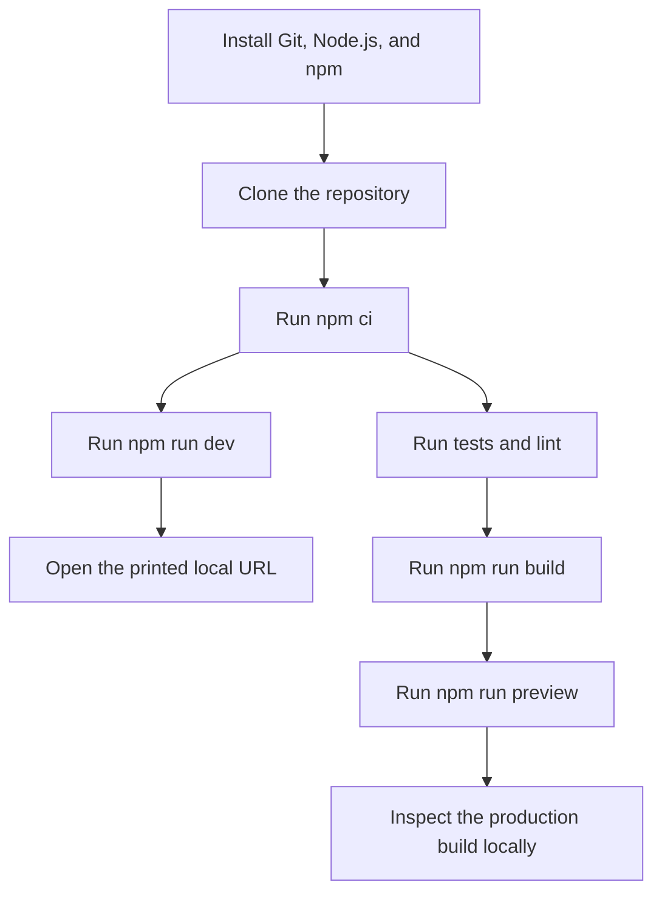

# Set up Sprint Progress Analyzer

You can run the app locally without a Jira account, API key, database, or environment file. It starts with fictional sprint data so you can explore it immediately.

## Setup at a glance



Use the development path while editing. Use the validation and preview path to check the built app before sharing it. Neither path requires a Jira account or environment file.

## 1. Check your tools

Install Git, Node.js 22.12 or newer, and npm. npm comes with Node.js. Check that they are available in your terminal:

```bash
git --version
node --version
npm --version
```

## 2. Download and install

```bash
git clone https://github.com/kchan1028/sprint-progress-analyzer.git
cd sprint-progress-analyzer
npm ci
```

If you already have the project locally, open a terminal in that folder and run `npm ci`. It installs the dependencies recorded in `package-lock.json`; keep that file in place.

## 3. Start the app

```bash
npm run dev
```

Keep the terminal running and open the local URL it prints. The usual address is http://localhost:5173. If that port is occupied, use the address printed by the server.

| Page | What to do there |
| --- | --- |
| `/` | Read the product overview. |
| `/dashboard` | Explore the fictional sprint and its risk signals. |
| `/analyze` | Import a Jira CSV export. |

Press **Ctrl+C** in the terminal to stop the server.

## 4. Try an import

Open `/analyze` and select [examples/sprint.csv](examples/sprint.csv). Enter November 2–16, 2026 as the sprint dates, then select **Import**. The example includes an unfamiliar `Discovery` status so you can practice correcting a mapping. Its dates are fixed, so time-based signals change as the calendar moves forward.

For your own data, first filter a Jira issue search to the intended sprint, then export it as CSV. The app requires an **Issue key** column. Include status, estimates, assignee, and timestamps for a more useful view.

Read [the user guide](docs/user-guide.md) for the full walkthrough and important limits of CSV history. Imported tickets disappear on refresh; status mappings and theme preferences remain saved in the browser.

## Optional configuration

Skip this section for ordinary local use. To provide deployment-specific public settings, copy the example file:

```bash
cp .env.example .env.local
```

Leave values empty unless you intend to configure the corresponding service:

| Variable | Purpose |
| --- | --- |
| `VITE_GA_MEASUREMENT_ID` | Optional Google Analytics page views, loaded only in production. |
| `VITE_ADSENSE_CLIENT_ID` | Public advertising publisher identifier. |
| `VITE_ADSENSE_SLOT_HOME` | Public homepage ad placement identifier. |
| `VITE_ADSENSE_SLOT_DASHBOARD` | Public dashboard ad placement identifier. |

Advertising script loading is currently disabled in the source; filling in identifiers does not enable it. No Jira credentials belong in these settings. All `VITE_*` values are exposed to the browser, so never use them for passwords, tokens, or private keys. Local environment files are ignored by Git.

Restart the development server after changing configuration, and rebuild before checking a production configuration. See the [README's data-handling notes](README.md#setup-and-configuration) before enabling optional third-party services.

## Check your changes

Run these from the project folder:

```bash
npm run test
npm run lint
npm run build
```

Tests check calculations, CSV parsing, workflow grouping, status mappings, and import error feedback. Lint checks source code, and the build runs TypeScript checks before creating the production files in `dist/`.

To inspect that build locally:

```bash
npm run preview
```

Open the URL printed in the terminal. Preview serves the built files; rerun `npm run build` after changing the source. It is for local verification, not a production hosting service.

## Common setup problems

| Problem | What to check |
| --- | --- |
| `node` or `npm` is not found | Install Node.js, reopen your terminal, and check the versions again. |
| Installation reports an unsupported Node version | Switch to Node.js 22.12 or newer, then rerun `npm ci`. |
| Installation cannot reach the package registry | Check your network and any organization proxy settings, then retry `npm ci`. |
| The browser cannot connect | Confirm the dev server is still running and use the exact URL printed in its terminal. |
| Import reports no issues | Check for an Issue key column and at least one nonempty ticket row. Read the import warnings. |
| Import dates are rejected | Provide both dates, with the end later than the start. |
| Imported data is gone after refresh | This is expected: tickets are held in memory. Re-import the file. |
| A status is grouped incorrectly | Check Saved Status Mappings and re-import after correcting the mapping. The workflow panel may also recognize the original status separately. |

For static hosting, publish the output of `npm run build` and configure requests for `/analyze` and `/dashboard` to fall back to `index.html`. The repository includes a `vercel.json` fallback configuration. Existing noindex metadata is preserved.

The setup workflow follows the project scripts and [Vite's getting-started guide](https://vite.dev/guide/). See [Vite's CLI documentation](https://vite.dev/guide/cli.html) for the distinction between development, build, and preview.
